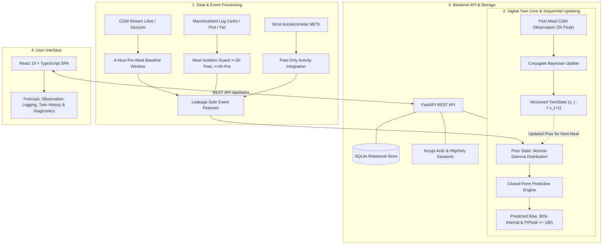

# GlycoTwin — Personalized Glucose Digital Twin

> **Medical & Regulatory Disclaimer:** GlycoTwin is an investigational research prototype developed for open-source exploration and hackathon demonstration. It is **not** a certified medical device, diagnostic system, or clinical decision support tool. It does not provide medical advice, diagnosis, treatment plans, or insulin/medication dosing recommendations. Nothing herein has undergone clinical trials or regulatory review. All forecasts and uncertainty metrics are experimental.

[](#c-project-title)
[](LICENSE)
[](#g-technical-stack)
[](#g-technical-stack)
[](#g-technical-stack)
[](#g-technical-stack)
[](#i-validation-plan-and-results)

---

## Table of Contents

- [Project Resources](#project-resources)
- [A. Team Details](#a-team-details)
- [B. College / Incubator Information](#b-college--incubator-information)
- [C. Project Title](#c-project-title)
- [D. Problem Statement](#d-problem-statement)
- [E. Healthcare Use Case](#e-healthcare-use-case)
- [F. Proposed Solution and Architecture](#f-proposed-solution-and-architecture)
- [G. Technical Stack](#g-technical-stack)
- [H. AI/ML Models, Frameworks, and Methodology](#h-aiml-models-frameworks-and-methodology)
- [I. Validation Plan and Results](#i-validation-plan-and-results)
- [J. Demo Video](#j-demo-video)
- [K. Open-Source License](#k-open-source-license)
- [L. Architecture Diagram](#l-architecture-diagram)
- [M. Project Presentation](#m-project-presentation)
- [N. Public GitHub Repository](#n-public-github-repository)
- [O. Reproducibility and Setup](#o-reproducibility-and-setup)
- [P. Limitations, Ethics, and Disclaimer](#p-limitations-ethics-and-disclaimer)
- [Repository Layout](#repository-layout)

---

## Project Resources

- **Public GitHub Repository:** [https://github.com/medhachoudhari/GlycoTwin](https://github.com/medhachoudhari/GlycoTwin)
- **Architecture Diagram (Google Slides):** [https://docs.google.com/presentation/d/1pNysqvddI37YxotE6ETBJYXENbabIwvL/edit?usp=sharing](https://docs.google.com/presentation/d/1pNysqvddI37YxotE6ETBJYXENbabIwvL/edit?usp=sharing)
- **Project Presentation (Google Slides):** [https://docs.google.com/presentation/d/1Q21n31nz-m1pwj7iUR0BUOL6iKSK9YoR/edit?usp=sharing](https://docs.google.com/presentation/d/1Q21n31nz-m1pwj7iUR0BUOL6iKSK9YoR/edit?usp=sharing)
- **YouTube Demo:** PENDING — URL will be added after upload.
- **Submission Deliverables Package:** `docs/submission/` (Architecture diagram & 10-slide presentation available in both PDF and PPTX).
- **Open-Source License:** [MIT License](LICENSE)

---

## A. Team Details

- **Team Name:** NeuralForge
- **Team Member:** Medha Choudhari
- **Role:** Student developer / project researcher
- **Institution:** Bapuji Institute of Engineering and Technology (BIET), Davangere, Karnataka, India
- **Team Size:** 1

---

## B. College / Incubator Information

- **Institution:** Bapuji Institute of Engineering and Technology (BIET), Davangere, Karnataka, India
- **Incubator Affiliation:** Not applicable

---

## C. Project Title

**GlycoTwin — Personalized Glucose Digital Twin**  
**Domain:** Healthcare AI, Digital Health, Machine Learning

---

## D. Problem Statement

Postprandial (post-meal) glycemic excursions exhibit substantial non-linear variability across individuals and between meals eaten by the same person. Differences in carbohydrate sensitivity, physical activity, baseline metabolic state, and diurnal variations make population-average formulas unreliable for individuals.

Existing machine learning approaches often train black-box population models that fail to convey prediction confidence, require massive centralized datasets, or treat glucose forecasting as static regression. 

**Research Question:**  
GlycoTwin investigates whether sequentially updated, personalized Bayesian digital twin models can forecast post-meal glucose-response outcomes (2-hour rise and probability of exceeding $\ge 180\text{ mg/dL}$) and quantify predictive uncertainty using Continuous Glucose Monitoring (CGM) traces and macronutrient meal logs in free-living adults not treated with insulin.

> *Note:* GlycoTwin does not claim to solve diabetes management or provide clinically validated forecasts. It is an investigational exploration of Bayesian parameter updating and uncertainty quantification.

---

## E. Healthcare Use Case

GlycoTwin is designed as an **exploratory research system** for personalized metabolic response modeling and uncertainty-aware decision intelligence:

1. **Quantifying Individual Metabolic Individuality:** Rather than forcing static population averages onto an individual, the system maintains a personalized metabolic state ($\beta_i$ carbohydrate sensitivity and optional $\gamma_i$ activity-interaction terms) that adapts sequentially as real meals and outcomes are reconciled.
2. **Transparent Uncertainty Representation:** For every meal forecast, GlycoTwin produces an analytical 90% predictive interval and a calibrated threshold probability ($P(\text{peak} \ge 180\text{ mg/dL})$), explicitly signaling when the digital twin has insufficient historical data or unstable pre-meal baseline readings.
3. **Research Decision Support:** Researchers can study the effects of conditioning carbohydrate sensitivity on wrist-worn accelerometer activity data in real-world cohorts.

**Distinction from Clinical Tools:** GlycoTwin does not calculate insulin boluses, prescribe carbohydrates, or diagnose pre-diabetes/diabetes. It provides a transparent, auditable computational framework for metabolic researchers.

---

## F. Proposed Solution and Architecture

GlycoTwin implements a complete end-to-end digital twin pipeline with strict temporal isolation, mathematical Bayesian updating, and an interactive full-stack interface.



### Architectural Components

1. **Data and Event Processing:**
   - Ingests CGM streams, macronutrient logs, and wrist-worn physical activity metrics (e.g., from the CGMacros study).
   - Enforces rigorous meal isolation: minimum 4-hour pre-meal baseline and 2-hour post-meal evaluation window without intervening meal events to prevent confounding glycemic contributions.
   - All features are strictly past-only; future outcome data is isolated by chronological splits and automated mutation tests.
2. **Forecasting Workflow:**
   - Evaluates pre-meal baseline glucose ($G_{\text{base}}$), meal carbohydrate intake ($C$), and pre-meal physical activity ($A$).
   - Computes analytical expected 2-hour glucose rise ($\widehat{\Delta G}$), predictive standard deviation ($\sigma_{\text{pred}}$), symmetric 90% predictive credible intervals, and exceedance probability $P(G_{\text{base}} + \Delta G \ge 180\text{ mg/dL}) = 1 - \Phi\left(\frac{180 - (G_{\text{base}} + \widehat{\Delta G})}{\sigma_{\text{pred}}}\right)$.
3. **Sequential Digital Twin Updates:**
   - Implements conjugate Bayesian Normal-Gamma updating.
   - For an observed post-meal rise $y$, the twin's precision matrix and mean parameter vector are updated in closed form without retraining on historic datasets or modifying prior versions.
   - Generates an immutable, versioned history of state transitions ($v_0 \to v_1 \to \dots \to v_t$).
4. **Uncertainty Estimation & Quality Diagnostics:**
   - Produces 90% analytical predictive intervals for glucose rise.
   - Tracks predictive calibration via rolling Brier scores evaluated on verified post-meal outcomes after $\ge 3$ reconciled meals.
   - Emits automated data-quality flags: identifies pre-meal baseline instability ($> 20\text{ mg/dL}$ standard deviation in pre-meal window) and low-history states without corrupting underlying probabilities.
5. **Backend API & Data Persistence:**
   - Built on FastAPI with SQLAlchemy 2.0 and SQLite.
   - Features per-user twin ownership, scrypt-hashed credentials, and HttpOnly session cookies.
   - Exposes REST endpoints for twin creation, forecast requests, observation logging, outcome reconciliation, and parameter audit trails.
6. **Frontend Interface:**
   - Single-page application built with React 19, TypeScript, and Vite.
   - Modular dashboards: Twin Status, New Meal Forecast, Observation Logging, History & Calibration Tracking, and a Prototype Scope & Diagnostics panel clearly detailing active vs. out-of-scope physiological variables.

---

## G. Technical Stack

| Layer | Technologies Confirmed in Repository |
|---|---|
| **Backend Framework** | Python 3.10+, FastAPI 0.110+, Uvicorn 0.29+, Pydantic v2 |
| **Data Persistence** | SQLite 3, SQLAlchemy 2.0 (ORM & relational schema) |
| **Authentication & Security** | Passlib (scrypt password hashing), cryptographic session tokens, HttpOnly cookies |
| **Frontend Framework** | React 19 (React DOM 19), TypeScript 5.6+, Vite 6 |
| **Styling & UI** | Custom Vanilla CSS design system (responsive, glassmorphic dark mode, accessible token hierarchy) |
| **ML & Scientific Computing** | NumPy $\ge 1.24$, Pandas $\ge 2.0$, SciPy $\ge 1.11$, Scikit-learn $\ge 1.3$, XGBoost $\ge 2.0$ |
| **Testing & Verification** | Pytest $\ge 7.4$, HTTPX $\ge 0.27$, Vitest 2.1+, Testing Library React 16.1+, JSDOM 25+ |

---

## H. AI/ML Models, Frameworks, and Methodology

### Implemented Model Architectures

1. **Model A (Population Baseline — XGBoost):**
   - Population-level gradient boosted tree model trained on tabular meal features, baseline glucose, and historical context.
   - Evaluated under participant-stratified 5-fold cross-validation (out-of-fold predictions only).
2. **Model B (Personalized Bayesian Linear Regression):**
   - Assumes personal post-meal rise proportional to carbohydrate intake:
     $$\Delta G = \beta_i \cdot \text{carbs} + \epsilon, \quad \epsilon \sim \mathcal{N}(0, \sigma^2)$$
   - Conjugate Normal-Gamma update adapts $\beta_i$ (carbohydrate sensitivity) meal by meal.
3. **Model C (Activity-Conditioned Personalized Bayesian Regression):**
   - Extends Model B by conditioning carbohydrate sensitivity on pre-meal physical activity:
     $$\Delta G = (\beta_i + \gamma_i \cdot \text{activity}) \cdot \text{carbs} + \epsilon$$
   - Uses mean METs (Metabolic Equivalent of Task) from a 4-hour pre-meal wrist-accelerometer window.

### Prior Formulations

- **Empirical Bayes Prior:** Derived from training-fold participant meal distributions to initialize twin parameters.
- **Blueprint Stratified Prior:** Stratifies prior parameters by glycemic status (normoglycemic, pre-diabetes, type 2 diabetes) with $\gamma$ centered at zero.

### Sequential / Prequential Evaluation Methodology

- All evaluations follow **strict prequential validation**: for each chronological meal event, a forecast is generated using only the parameter state available prior to the meal. Only after the forecast is recorded is the observed 2-hour peak revealed to execute the Bayesian update.
- Clustered percentile bootstrap (1,000 resamples at participant level) evaluates differences between models.

### Real-Data Scientific Findings (Libre Channel, 963 Matched Meals, 34 Participants)

As documented in `docs/model_b_vs_c_report.md`, matched real-data comparison yielded the following verified empirical results:

| Metric | Model B (Carbs Only) | Model C (Carbs + Activity) | Difference (C − B) | 95% Clustered CI | Statistically Significant? |
|---|---|---|---|---|---|
| **ROC-AUC** | 0.7943 | 0.8059 | +0.0116 | [-0.0084, +0.0479] | **No** (CI spans 0) |
| **PR-AUC** | 0.5792 | 0.5890 | +0.0098 | [-0.0109, +0.0356] | **No** (CI spans 0) |
| **Brier Score** | 0.1391 | 0.1379 | -0.0012 | [-0.0064, +0.0030] | **No** (CI spans 0) |
| **Log Loss** | 0.4510 | 0.4500 | -0.0010 | [-0.0210, +0.0151] | **No** (CI spans 0) |
| **Rise MAE (mg/dL)** | 29.40 | 29.51 | +0.11 | [-0.52, +0.68] | **No** (CI spans 0) |
| **Mean Rise Error (mg/dL)** | -9.08 | -8.13 | +0.95 | [+0.01, +2.26] | Yes (bias reduction only) |
| **90% Interval Coverage** | 0.8951 | 0.8941 | -0.0010 | [-0.0135, +0.0122] | **No** (both near 90%) |

### Scientific Conclusion: Inconclusive

The matched comparison between Model B and Model C showed that 8 of 9 evaluated intervals contain zero. The addition of wrist-accelerometer activity did **not** demonstrate statistically significant predictive or calibration superiority over the simpler carbohydrate-only model in this 34-participant cohort. GlycoTwin reports this negative/inconclusive finding transparently rather than claiming unverified improvements.

---

## I. Validation Plan and Results

### 1. Automated Test Suite

- **Python Backend & Research Core:** **815 tests passing** (0 failures, 0 errors).
  - Data ingestion, meal extraction, and feature schema verification.
  - Bayesian update mathematical invariants and matrix algebra.
  - API routers, session authentication, ownership isolation, and error handling.
  - Leakage mutation tests.
- **Frontend Test Suite:** **39 unit and integration tests passing** in Vitest (0 warnings, 0 errors).
  - Navigation, authentication, guest flows, and state management.
  - Forecasting forms, observation submission, and outcome reconciliation.
  - Scope and diagnostics rendering.
- **TypeScript Static Verification:** Full compilation passing with zero type errors (`tsc --noEmit`).

### 2. Leakage and Data-Quality Audits

- **Chronological Boundary Enforcement:** Training and evaluation windows use strict forward-in-time splitting.
- **Leakage Mutation Tests:** Pipeline unit test (`src/glycotwin/data/leakage_check.py`) intentionally perturbs future post-meal CGM values; assertion verifies that extracted pre-meal baseline and features remain completely invariant.
- **CGM Sampling Checks:** Verified non-uniform sampling and interpolation characteristics (`scripts/audit_cgm_sampling_phase.py`).

### 3. Uncertainty and Calibration Analysis

- Evaluated using expected calibration error (ECE), Brier loss, and empirical coverage of 90% predictive credible intervals.
- The 90% analytical predictive interval achieved **89.51% empirical coverage** on real test meals, demonstrating reliable uncertainty calibration.

---

## J. Demo Video

YouTube Demo: PENDING — URL will be added after upload.

---

## K. Open-Source License

This project's code is licensed under the [MIT License](LICENSE).

```text
MIT License
Copyright (c) 2026 Medha Choudhari
```

> **Dataset Licensing Notice:** The CGMacros research dataset utilized for offline retrospective analysis is licensed separately under Creative Commons Attribution-NonCommercial-ShareAlike 4.0 International ([CC BY-NC-SA 4.0](https://creativecommons.org/licenses/by-nc-sa/4.0/)). Code license terms apply solely to the source code of this repository and grant no rights to the CGMacros dataset.

---

## L. Architecture Diagram

- [Architecture Diagram (Google Slides)](https://docs.google.com/presentation/d/1pNysqvddI37YxotE6ETBJYXENbabIwvL/edit?usp=sharing)
- *Local Document:* `docs/submission/GlycoTwin_Architecture.pdf` (and editable `.pptx`)

---

## M. Project Presentation

- [Project Presentation (Google Slides)](https://docs.google.com/presentation/d/1Q21n31nz-m1pwj7iUR0BUOL6iKSK9YoR/edit?usp=sharing)
- *Local Document:* `docs/submission/GlycoTwin_Presentation.pdf` (and editable `.pptx`)

---

## N. Public GitHub Repository

- **Source Code Repository:** [https://github.com/medhachoudhari/GlycoTwin](https://github.com/medhachoudhari/GlycoTwin)

---

## O. Reproducibility and Setup

Follow these steps to run GlycoTwin locally on Windows (PowerShell) or Linux/macOS.

### Prerequisites

- Python $\ge$ 3.10
- Node.js $\ge$ 18.0.0 and npm $\ge$ 9.0.0

### Step 1: Clone Repository

```powershell
git clone https://github.com/medhachoudhari/GlycoTwin.git
cd GlycoTwin
```

### Step 2: Python Environment Setup

```powershell
python -m venv .venv
.venv\Scripts\Activate.ps1
pip install --upgrade pip
pip install -r requirements.txt
pip install -e .
```

### Step 3: Run Automated Test Suites

```powershell
# Run the complete Python test suite (815 tests)
pytest

# Run frontend test suite (39 tests)
cd frontend
npm install
npm test
cd ..
```

### Step 4: Initialize the Local Database

Initialize the SQLite database schema and generate a synthetic demo twin:

```powershell
python scripts\init_db.py --demo
```

### Step 5: Start the Backend Service (Terminal 1)

```powershell
# From project root
.venv\Scripts\Activate.ps1
python -m uvicorn glycotwin.backend.app:app --host 127.0.0.1 --port 8000 --reload
```

The interactive API documentation is accessible at `http://127.0.0.1:8000/docs`.

### Step 6: Start the Frontend Application (Terminal 2)

```powershell
# In a new PowerShell terminal
cd frontend
npm run dev
```

Open your browser at `http://127.0.0.1:5173/`.

### Interactive Exploration Walkthrough

1. Navigate to `http://127.0.0.1:5173/`.
2. Click **Create account** or click **Continue as demo** for a zero-setup temporary guest session.
3. Open **My Twins** to review your active twin or claim the synthetic demonstration twin.
4. Go to **New Forecast**: Enter a meal (e.g., 50g carbohydrates, 100 mg/dL baseline glucose) to generate an immediate forecast with 90% predictive interval.
5. In **Observations**, log the actual 2-hour post-meal glucose reading to trigger closed-loop Bayesian reconciliation.
6. Check **History & Calibration** to inspect how carbohydrate sensitivity ($\beta_i$) updates and review the rolling Brier calibration score.

---

## P. Limitations, Ethics, and Disclaimer

### Clinical and Regulatory Disclaimer

GlycoTwin is an academic research prototype. It is **not** a cleared, approved, or CE-marked medical device. It must **not** be used for:
- Clinical decision-making or diagnostic screening.
- Insulin dose adjustment, insulin pump tuning, or medication changes.
- Replacing medical advice from endocrinologists or licensed healthcare providers.

### Explicit Model & Data Limitations

1. **Investigational Cohort Size:** Empirical evaluations were conducted on 34 non-insulin-treated participants from a single observational dataset (CGMacros). Generalizability to diverse demographic groups or individuals on insulin therapy has not been established.
2. **Unsupported Features:** The current prototype does **not** include:
   - Continuous electrocardiogram or heart-rate telemetry integration.
   - Clinical laboratory biomarkers (HbA1c, fasting insulin, C-peptide, lipid profiles).
   - Step counts or fine-grained inertial motion kinematics.
   - Dynamic gastrointestinal gastric emptying or carbohydrate absorption curves.
3. **Sensor Discrepancy:** Continuous glucose monitors exhibit sensor lag and measurement noise. Inter-sensor comparison showed that Libre and Dexcom sensors disagreed on threshold exceedance labels in approximately 23% of matched meal events.
4. **Self-Reported Nutrition:** Meal logs rely on self-reported macronutrient estimates, introducing natural measurement error into carbohydrate inputs.
5. **Gaussian Distribution Assumptions:** The closed-form conjugate update assumes Gaussian likelihood with fixed residual variance; extreme non-linear glycemic excursions may exhibit skewness not fully captured by linear models.

---

## Repository Layout

```text
src/glycotwin/
├── backend/                  FastAPI service: auth, security, ownership, routers, store
│   ├── app.py                FastAPI application entry point
│   ├── auth_service.py       Session management and password authentication
│   ├── security.py           Scrypt hashing & token validation
│   ├── ownership.py          Per-account twin isolation
│   └── routers/              API route controllers (twins, forecast, observations, reconcile)
├── data/                     Ingestion, meal extraction, and data integrity
│   ├── meals.py              Meal window isolation and gap exclusion
│   ├── events.py             Feature extraction and event table generator
│   └── leakage_check.py      Automated temporal leakage mutation audit
├── models/                   Machine learning models and evaluation harness
│   ├── baseline.py           Model A (Population XGBoost cross-validated)
│   ├── bayesian.py           Model B and Model C conjugate Bayesian implementations
│   ├── evaluation.py         Prequential evaluation metrics (Brier, ECE, MAE, AUC)
│   └── model_bc_compare.py   Matched paired B-vs-C bootstrap comparator
└── twin/                     Digital twin state and lifecycle engine
    ├── state.py              Versioned TwinState and Bayesian lifecycle updates
    ├── quality.py            Data-quality and insufficient-history checks
    ├── state_view.py         Composed TwinState view and diagnostic reporting
    └── insight.py            Analytical parameter history and what-if evaluation

frontend/                     React 19 + TypeScript + Vite frontend
├── src/
│   ├── dashboard/            Modular dashboard views, forms, panels, and diagnostics
│   ├── auth/                 Authentication context, session hooks, and login views
│   └── services/             Backend HTTP client and API wrappers
└── tests/                    Vitest component and integration tests

scripts/                      Operational, evaluation, and database scripts
├── init_db.py                Database table initialization and demo twin seeding
├── claim_twin.py             Administrative twin ownership transfer
├── compare_models_b_c.py     Matched paired model comparison runner
└── run_experiment.py         Prequential cross-validation harness

docs/                         Scientific documentation and engineering audits
├── ARCHITECTURE.md           Detailed system architecture and data flows
├── BACKEND.md                API endpoints and authentication design
├── GLYCOTWIN_COMPLETE_TEST_REPORT.md Comprehensive audit of all passing tests
├── model_b_vs_c_report.md    Complete matched real-data empirical results
└── data_validity_rules.md    Scientific ingestion rules and exclusion criteria
```
